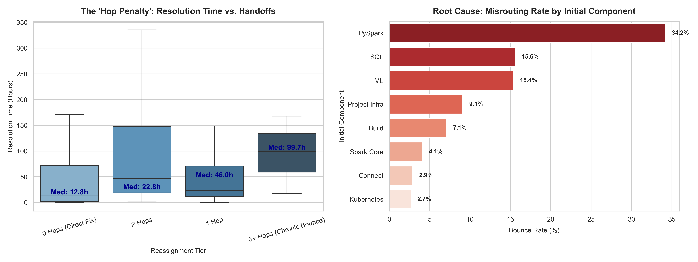

# IT Service Desk Bottleneck & Ticket Reassignment Diagnostic

## Executive Summary
This project investigates the root causes of elevated Mean Time to Resolution (MTTR) within enterprise IT service operations. Using audit logs extracted from Apache's production Jira instance (SPARK project), this analysis models ticket lifecycle durations across component handoffs to isolate triage misrouting and quantify the operational delay caused by inter-team reassignments.

## Key Findings
- **The "Hop Penalty":** Tickets resolved without reassignment had a median MTTR of **12.8 hours**, whereas tickets subjected to 3+ component reassignments had a median MTTR of **99.7 hours** (~7.8x increase).
- **Misrouting Drivers:** 
  - **PySpark** exhibited a **34.2% bounce rate**, the highest among high-volume engineering components.
  - **SQL** issues had the highest median resolution latency (**86.9 hours**) with a 15.6% bounce rate.
- **Cross-Cutting Ticket Friction:** Issue types tagged as **Test (58.8% bounce rate)** and **Task (40.0% bounce rate)** lacked clear initial component ownership, resulting in frequent inter-team bouncing.

## Visualizations


## Strategic Recommendations
1. **Intake Triage Checklist:** Introduce a mandatory 3-field diagnostic intake checklist for API and cross-cutting issues to prevent first-hop routing errors.
2. **Clear Ownership for Test Frameworks:** Define strict routing boundaries between high-level language wrappers (PySpark) and core execution engines (SQL/Core).
3. **Queue In-Transit SLA:** Enforce an automated alert on tickets sitting unassigned after a reassignment to reduce idle wait time.

## Project Structure
```text
it_ticket_bottleneck_analysis/
├── data/                                 # Local event data
├── ticket_bottleneck_analysis.ipynb      # End-to-end data pipeline and analysis
├── ticket_bottleneck_analysis.png        # Analytical charts
└── README.md                             # Project documentation